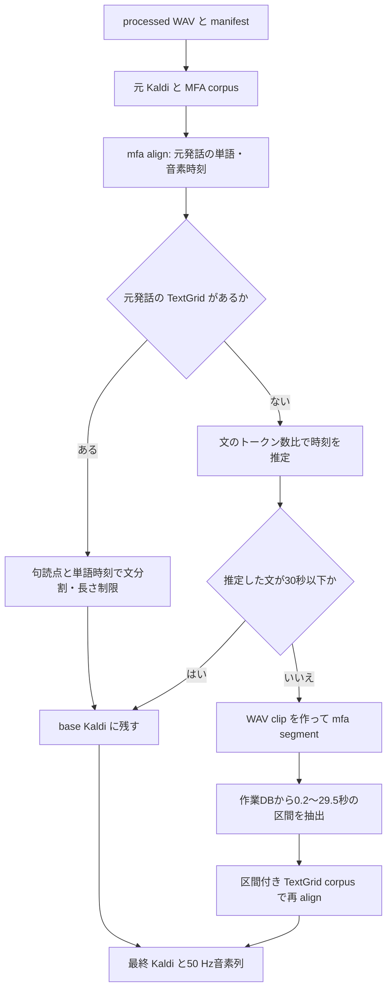

# SAP 文単位分割 Kaldi データの作成

## 概要

SAP の processed WAV と manifest から、文単位の Kaldi データと50 Hzの音素ラベルを作成する。
処理は次の順番で行う。

1. **元発話の Kaldi と MFA 用 corpus を作る。**
2. **元発話に `mfa align` を実行する。** 単語・音素の時刻を取得する。
3. **`origin.wrd` の句読点を使って文単位に分割する。**
   TextGrid がある発話は単語時刻で分割し、長い区間もここで分割する。
   TextGrid がない発話は、文のトークン数比で時刻を推定する。
4. **TextGrid がない経路で30秒を超える文に `mfa segment` を実行する。**
5. **MFA segment の作業DBから区間を取り出し、再度 `mfa align` を実行する。**
6. **文分割した区間を結合し、最終 Kaldi と50 Hzの音素ラベルを作る。**

一連の処理は [`run_sap_sentence_split_kaldi.sh`](run_sap_sentence_split_kaldi.sh) が実行する。
**`mfa align` と `mfa segment` の呼び出しもこのスクリプトに含まれる。**
MFA 本体とモデルは、あらかじめ Conda 環境に用意する。
`asr3/local` は `asr2/local` へのシンボリックリンクで、同じ処理を使う。
ASR 学習用の `run.sh` からは呼ばれないため、データ準備として先に実行する。

最終出力:

```text
<base>/kaldi_sentence_first_mfa_with_unaligned_short/<split>/
```

`<base>` は `SAP0430_processed` のルート、`<split>` は `train dev test1 test2` を指す。

## 実行コマンド

現在の既定パスを使う場合:

```bash
cd /home/hojo/espnet_dsu/egs2/sap/asr2
local/run_sap_sentence_split_kaldi.sh --splits train dev test1 test2
```

データや Conda のパスを指定する場合:

**`--base` と `--conda-sh` は使用する環境の絶対パスを指定する。**
既定値はそれぞれ `/home/hojo/dataset/SAP0430_processed` と
`/home/hojo/anaconda3/etc/profile.d/conda.sh` なので、実際の配置に合わせて変更する。
相対 `--base` は生成する音声 symlink の参照を壊す可能性がある。

```bash
cd /path/to/espnet_dsu/egs2/sap/asr2
base=/absolute/path/to/SAP0430_processed
local/run_sap_sentence_split_kaldi.sh \
  --base "$base" \
  --conda-sh /absolute/path/to/miniconda3/etc/profile.d/conda.sh \
  --conda-env aligner \
  --jobs 16 \
  --segment-jobs 8 \
  --splits train dev test1 test2
```

特定 split だけなら `--splits test1 test2` などに変更する。
処理開始時に**指定 split の既存 Kaldi、最終 Kaldi、corpus、切り出し WAV、関連作業領域を削除して作り直す**。
入力の `manifest/` と `data/processed/` は削除しない。
既存結果を比較・保存したい場合は、別の `base` に必要入力を置いて実行する。

元発話の TextGrid を再利用する場合のみ、上のコマンドに `--skip-original-align` を追加する。
これは `mfa/aligned/<split>_textgrid` を残して最初の align を省く指定であり、
他の中間出力・最終出力は作り直される。
同じID・転記・音声に対する **short TextGrid** がそろっていることを先に確認する。
存在確認を行ってから停止する機能はなく、不足すると未整列発話の扱いになって結果が変わる。

## 入力ファイル

次のディレクトリ構造を入力として用意する。以降、このルートを `base` と呼ぶ。

```text
SAP0430_processed/
├── manifest/
│   ├── <split>.tsv
│   ├── <split>.origin.wrd
│   ├── <split>.wrd.without.parentheses
│   └── <split>.transcripts.tsv          # 任意。test1/test2 に存在
└── data/processed/<split>/*.wav
```

`<split>` は `train dev test1 test2`。
`data/doc/`、`*.wrd.with.parentheses` はこの wrapper の必須入力ではない。
`mfa/` と既存の `kaldi*/` は新規に全処理を実行する場合は不要。

- `<split>.tsv` は先頭1行がヘッダーで、以降は `wavパス<TAB>サンプル数`。
  2つの `.wrd` は発話IDを付けない1発話1行で、TSV のヘッダー以降と**行順・行数を一致**させる。
- TSV 内の絶対パスが実際の配置と異なっていても、wrapper 配下の Python は
  **ファイル名の stem から `<base>/data/processed/<split>/<id>.wav` を参照し直す**。
  TSV のパスを一括置換する必要はない。サンプル数も wrapper の長さ計算には使わず、WAV ヘッダーから実測する。
- `origin.wrd` は句読点を含む文境界の情報、`wrd.without.parentheses` は Kaldi の正解語列。
  この2つを同じファイルで代用しない。元 Kaldi/MFA `.lab` を作る際は正解語列を大文字化する。
- `transcripts.tsv` があれば `id` と `speaker` 列で話者を取得する。
  なければ `utt.rsplit("_", 2)[0]` を使用する。現在の train/dev にはこの TSV がない。
- 現在の各 split の先頭 WAV は16 kHz・モノラル・16 bit PCM。
  このパイプライン自体にはリサンプリング処理がなく、Python の `wave` で読める WAV が必要。

**元配布からの再作成範囲:** 現在の train/dev manifest は2024年の既存ファイルであり、
リポジトリ内に train/dev の原配布からこれらを生成する処理は確認できない。
同じデータを再現するには、既存の processed WAV と manifest を入力として使う。
任意の SAP 配布をこの wrapper に渡せば自動的に同じ train/dev ができるわけではない。

<details>
<summary>test1/test2 の processed 入力を SAPC2 から作る場合</summary>

既存 test1/test2 の processed 入力があれば、この処理は不要。
補助スクリプトは **SAPC1 の test1/test2 のIDリストを使い、SAPC2 の Train/Dev 配布から
該当 WAV と転記を抽出**する。SAPC2 の split 名をそのまま実験の split にする処理ではない。

必要なもの:

- `--sapc1-dir` に `test1.tsv` と `test2.tsv`（選択するIDとサンプル数）。
- `--sapc2-root` に `manifest/Train.jsonl`、`manifest/Dev.jsonl`、
  各レコードの `audio_filepath` に対応する WAV と同じディレクトリの `<speaker>.json`。

```bash
cd /path/to/espnet_dsu/egs2/sap/asr2
python local/extract_sapc1_test_from_sapc2.py \
  --sapc1-dir /path/to/SAPC1 \
  --sapc2-root /path/to/SAPC2-train-dev \
  --output-root /absolute/path/to/SAP0430_processed \
  --dry-run
```

確認後、同じコマンドから `--dry-run` を外すと、両 test split の WAV、
`data/doc/<speaker>.json`、3種類の `.wrd`、`.tsv`、`.transcripts.tsv` を書き出す。
正規化はこのスクリプトの `normalize_without_parentheses()` に従う。
既存の同名出力は上書きされる。
`asr2/SAPC1` の既定パスと SAPC2 配布は今回の環境には存在しないため、これらは別途確保する。
train/dev の生成にはこの補助処理を使えない。

</details>

## MFA 環境とモデル

既存データの MFA 実行履歴は **Montreal Forced Aligner 3.3.8**。
現在の `aligner` 環境の Python は3.13.11（当時の Python バージョンは履歴からは未確認）。
Python 補助処理は標準ライブラリのみを使用する。

新しく用意する場合の開始点は次のとおり（依存パッケージ解決・全処理の動作は構築した環境で確認する）。

```bash
conda create -n aligner -c conda-forge python=3.13.11 montreal-forced-aligner=3.3.8
conda activate aligner
mfa version
mfa segment --help
mfa model download dictionary english_us_arpa
mfa model download acoustic english_us_arpa
mfa model download g2p english_us_mfa
```

リポジトリ共通の `tools/installers/install_mfa.sh` は **MFA v2.0.6** を導入するため、
今回確認した3.3.8環境の再現用には使わない。
この処理は `mfa segment` とその作業DBのスキーマに依存する。

| 用途 | wrapper の既定値 |
|---|---|
| Conda 環境 | `aligner` |
| 辞書 | `english_us_arpa` |
| 音響モデル | `english_us_arpa` |
| G2P | `english_us_mfa` |
| align 並列数 | `--jobs 16` |
| segment 並列数 | `--segment-jobs 8` |
| TextGrid 形式 | `short_textgrid` |

<details>
<summary>環境定義・モデルを保存して同じ条件を使う場合</summary>

既存の Conda 環境を記録する例:

```bash
source /home/hojo/anaconda3/etc/profile.d/conda.sh
conda env export -n aligner --no-builds > /path/to/archive/aligner.yml
conda list -n aligner --explicit > /path/to/archive/aligner-explicit.txt
```

保存した環境定義から構築する場合、`aligner.yml` 末尾の `prefix:` があれば旧パスなので除去する。
同じOS・アーキテクチャでパッケージを固定する場合は explicit ファイルも使える。

モデル名が同じでも再ダウンロード時の中身が一致するとは限らない。
厳密な比較用には既存の次のファイルも保存する。
現在は `/home/hojo/Documents/MFA/pretrained_models/` にある。

| 相対パス | 現環境での SHA-256 |
|---|---|
| `dictionary/english_us_arpa.dict` | `e8c6c7b036ae2b7c78d2768b8dc6b1f9359175b842956d00b48c53c9c332e6b0` |
| `acoustic/english_us_arpa.zip` | `d35ce271ded357d833d2f4b8d1041dc3748b9538567ba13f2c697f4e4126711b` |
| `g2p/english_us_mfa.zip` | `9923b38d59a8b3e3e322f225c52523c2a6248e5ffc9fd89be151ade2dc97cb02` |

保存したモデルを直接指定する場合は、wrapper の `--dictionary`、`--acoustic-model`、
`--g2p-model` にそれぞれ辞書・zip の絶対パスを渡せる。
`command_history.yaml` と `global_config.yaml` も再現条件の記録として保存する。
現環境のグローバル設定は `seed: 0`、`blas_num_threads: 1`、`use_postgres: false`。
wrapper はこれらを明示的には上書きしない。グローバル設定ファイル全体には環境固有のパスも含まれる。

</details>

## 出力ファイル

最終出力は `<base>/kaldi_sentence_first_mfa_with_unaligned_short/<split>/`。

| ファイル | 内容 |
|---|---|
| `wav.scp` | recording ID → WAV パス |
| `segments` | 発話ID、recording ID、開始秒、終了秒 |
| `text` | 発話ID、正解語列 |
| `utt2spk` / `spk2utt` | 話者対応 |
| `utt2phones_50hz` | 発話ID、20 msごとの音素列 |
| `utt2num_frames_50hz` | 発話ID、音素列の長さ |
| `missing_phone_labels` | 音素を取得できなかった発話と理由（ヘッダー付きTSV） |

文分割IDは通常 `_sent001`、segment 後はさらに `_mfasg001` を付ける。
音素が得られない発話も正解文と音声区間を残し、音素列は**発話IDだけの行**、フレーム数は **0** とする。
フレーム数0は音声自体の長さ0を意味しない。

`segments` の時刻は `wav.scp` の recording を基準にする。
通常の文分割は**元 WAV 内の時刻**、MFA segment 経由は
`mfa/audio_sentence_first_long/<split>/<speaker>/*.wav` **内の時刻**になる。
最終 Kaldi だけをコピーしても、これらの WAV が参照先に存在しなければ使えない。

主な中間出力:

| パス（`<base>/` からの相対） | 用途 |
|---|---|
| `kaldi/<split>` | 元発話の Kaldi |
| `mfa/corpus/<split>` | 元発話の align 入力 |
| `mfa/aligned/<split>_textgrid` | 元発話の単語・音素時刻 |
| `kaldi_sentence_first_base/<split>` | MFA segment 経由の区間を足す前の Kaldi |
| `mfa/audio_sentence_first_long/<split>` | 長い未整列文の実 WAV clip。最終データからも参照 |
| `mfa/corpus_sentence_first_long_for_segment/<split>` | segment 入力 |
| `mfa/segmented/sentence_first_long/<split>` | segment 出力 |
| `mfa/corpus_sentence_first_segmented_for_align/<split>` | DB 抽出後の再 align 入力 |
| `mfa/aligned/sentence_first_segmented_long/<split>_textgrid` | clip の音素時刻 |
| `mfa/temp/` | 作業DB・ログ。DB 抽出前に削除しない |
| `mfa/analysis_sentence_first/` | 集計・採用区間・除外理由 |

集計は `base_summary.tsv`、`sentence_first_mfa_segment_summary.tsv`、
`sentence_first_final_summary.tsv`、`sentence_first_final_source_summary.tsv`。
これらの**共通 summary は実行対象 split だけで上書き**される。
現在は最後に test1/test2 を実行したため、その2 split しか載っていない。
train/dev の再現確認には最終ディレクトリも直接調べる。
除外は `<split>_excluded.tsv` と `<split>_sentence_first_mfa_segment_skipped.tsv` で確認できる。
旧方式の `mfa/analysis/`、`mfa/analysis_sentence/`、`kaldi_sentence_mfa*` はこの wrapper の入力ではない。

## 処理の詳細



1. **元 Kaldi / corpus:** `prepare_original_kaldi_and_mfa_corpus.py` が
   `kaldi/<split>` と `mfa/corpus/<split>/<speaker>/{id.wav,id.lab}` を作る。
   corpus の WAV は元 WAV への symlink。
2. **元発話の align:** wrapper が `mfa align` を呼び、
   `mfa/aligned/<split>_textgrid` に `words` / `phones` tier を持つ short TextGrid を出す。
3. **文分割:** `build_sentence_split_base_and_long_corpus.py` が
   `origin.wrd` の `[...]` と `(...)` を除去し、`. ! ?` を文境界として使用する。
   正規化後の語列との対応は編集距離による探索、長文（80トークン超または6文超）はトークン数比で求める。
   - **TextGrid がある場合:** 1文かつ30秒以下は元発話をそのまま保持。
     それ以外は `words` の時刻を使用し、前後50 msの余白、目標上限29.5秒、最小0.1秒で分割する。
     正解語数と MFA 単語数が異なる場合の対応も比例位置に依存する。
     この経路で `mfa segment` は呼ばない。
   - **TextGrid がない場合:** 文ごとの開始・終了を正規化語列のトークン数比で推定する。
     0.1秒未満は採用せず、30秒以下なら base に保持する。
     これは音響的に検証された文境界ではない。
     **30秒を超える推定文だけ**実ファイルに切り出して segment 用 corpus に出す。
   - TextGrid ファイルがあっても有効な単語区間が得られない場合は、
     未整列経路へ戻さず `no_sentence_segments` として除外される場合がある。
4. **長い未整列文の segment:** wrapper が `mfa segment --no_cuda` を実行する。
   対象が0件ならその split の segment は省略。
   出力 TextGrid だけでなく、次の SQLite DB を保持するため `--no_final_clean` を指定する。

   ```text
   mfa/temp/segment_sentence_first_long_<split>/<split>/<split>.db
   ```

5. **DB 抽出:** `export_mfa_segment_db_to_align_corpus.py` が
   `utterance` / `file` / `speaker` / `sound_file` を読み、空転記、0.2秒未満、29.5秒超を除外する。
   採用区間を `mfa/corpus_sentence_first_segmented_for_align/<split>` に
   clip WAV の symlink と区間転記入り TextGrid として書く。
   DB が見つからない場合は0件として続行するため、長文があったのに抽出0件なら調査が必要。
6. **再 align:** wrapper がこの corpus に再度 `mfa align` を実行し、
   `mfa/aligned/sentence_first_segmented_long/<split>_textgrid` に音素時刻を出す。
   base 側の全発話を再 align する処理ではない。
7. **最終出力:** `build_final_segmented_kaldi_with_phones.py` が base と DB 抽出区間を結合し、
   重複ID、recording の欠落、30秒超がないことを確認して出力する。
   `phones` tier の各20 msフレーム中央の音素をラベルにし、空ラベル・区間外は `SIL` とする。

## 各スクリプトの役割と SAP0430_processed 内のスクリプトとの対応

`SAP0430_processed/scripts/` のスクリプトは移植元。
以下の5本は、現時点ではデータルートを環境変数で指定できるようにしたことと、
共通処理の import 先をリポジトリ内に変更したこと以外、対応する実装が同じ。
**リポジトリ側のスクリプトを使用する。** データ置き場のスクリプトとの対応は次のとおり。

| `SAP0430_processed` 内 | リポジトリの `asr2/local/` 内 | 役割 |
|---|---|---|
| `scripts/prepare_kaldi_and_mfa_corpus.py` | `prepare_original_kaldi_and_mfa_corpus.py` | 元発話の Kaldi と MFA corpus 作成 |
| `scripts/build_sentence_kaldi_from_mfa.py` | `sap_sentence_split_utils.py` | 文境界・単語時刻の共通処理。wrapper は import して使う |
| `scripts/build_sentence_first_base_and_corpus.py` | `build_sentence_split_base_and_long_corpus.py` | 文分割と長い未整列文の切り出し |
| `scripts/export_sentence_first_segment_db.py` | `export_mfa_segment_db_to_align_corpus.py` | MFA の SQLite DB から分割結果を取り出す |
| `scripts/build_sentence_first_mfa_final.py` | `build_final_segmented_kaldi_with_phones.py` | 最終 Kaldi と50 Hz音素列の作成 |

そのほかのスクリプトは次の扱い。

- 両方にある `make_kaldi_data.py` は同一内容だが、**文分割も MFA も行わない単純変換**。
  wrapper はこれを使わない。話者IDを最初の `_` より前から取得し、長さを manifest の
  サンプル数÷16000で計算するため、wrapper 側の変換と同じ扱いにはできない。
  単独使用する場合は `--root` を明示する（既定値はスクリプトのあるディレクトリ）。
- `scripts/get_alignment.py` は torchaudio の `MMS_FA` を使う別の試行用コード。
  現在の MFA パイプラインからは呼ばれない。
- `sap_sentence_split_utils.py` を直接実行すると、旧方式の
  `kaldi_sentence_mfa*` を作る。現在の最終データを作る入口にはしない。
- `local/extract_sapc1_test_from_sapc2.py` は test1/test2 の入力を復元する補助処理。
  使用条件とコマンドは「入力ファイル」を参照する。

## レシピの data/ に配置する

wrapper は `<base>` 配下まで作り、`egs2/sap/asr{2,3}/data/` への配置は行わない。
対象の `data/<split>` がまだない状態なら、次のようにコピーする。
既存 `data/` に上書きすると、過去の `utt2phones` 等が残るため、新しい配置先で行う。

```bash
cd /path/to/espnet_dsu/egs2/sap/asr2
base=/absolute/path/to/SAP0430_processed
for s in train dev test1 test2; do
  test ! -e "data/$s" || { echo "data/$s already exists" >&2; exit 1; }
done
mkdir -p data
for s in train dev test1 test2; do
  cp -a "$base/kaldi_sentence_first_mfa_with_unaligned_short/$s" "data/$s"
done
# 現在の train/dev はファイル名を変更している。空音素行も残す。
for s in train dev; do
  mv "data/$s/utt2phones_50hz" "data/$s/utt2phones"
done
```

`asr3` にも必要なら、同様に `asr3` を作業ディレクトリとして配置する。
現在の train/dev の `utt2phones` は生成物の `utt2phones_50hz` とバイト単位で一致し、
test1/test2 は `utt2phones_50hz` の名前のまま置かれている。
必要な音素評価用ファイルは、別途次で作る。

```bash
python local/utt2phones_to_tsv.py --output-format tsv train dev
python local/utt2phones_to_tsv.py --output-format utt2phones train dev
```

出力は `data/phoneme_alignment/{train,dev}.{tsv,utt2phones}`。
この変換では**既定で空音素行を除く**。全発話を保持したい用途では `--keep-empty` を使う。
学習用の速度摂動や `dump/` の作成は、この準備の後で各 ASR レシピが行う。

既存 Kaldi を再生成せずに移す場合は、`data/processed/` と上記 clip WAV も移し、
`wav.scp` に残る元のパスを配置先のルートに直す必要がある。
実際に現在の `asr3/data/dev/wav.scp` だけは `/mnt/nvme_data02/hojo/datasets/SAP0430_processed`
へ移送済みのパスで、`asr2` と異なる。コピー元の絶対パスをそのまま使わない。

## 確認方法

2026-10-28 に最終 Kaldi を直接数えた参考値。時間は保存済み `segments` の3桁秒から計算した値。
再 align は環境やモデルの違いで結果が変わり得るので、件数一致だけで完全再現とは判断しない。

| split | 入力発話数 | 最終発話数 | 時間 [h] | 話者数 | 最大長 [s] | 空音素行 |
|---|---:|---:|---:|---:|---:|---:|
| train | 131420 | 166722 | 273.071440 | 369 | 29.993 | 30931 |
| dev | 19275 | 24848 | 40.903328 | 55 | 29.980 | 4341 |
| test1 | 18397 | 24981 | 39.656297 | 50 | 29.950 | 5715 |
| test2 | 17752 | 22273 | 36.963721 | 50 | 29.734 | 4702 |

<details>
<summary>発話ID・音声参照・区間長・音素列長を検証するコマンド</summary>

次の検証は読み取りのみ。発話ID・音声参照・30秒制限・音素列長の整合性を確認する。
`wav.scp` は発話単位ではなく recording 単位なので、`text` と行数が一致する必要はない。

```bash
export SAP_PROCESSED_DIR=/absolute/path/to/SAP0430_processed
python - <<'PY'
import os
from pathlib import Path

base = Path(os.environ["SAP_PROCESSED_DIR"])
for split in ("train", "dev", "test1", "test2"):
    root = base / "kaldi_sentence_first_mfa_with_unaligned_short" / split
    def table(name):
        result = {}
        for line in (root / name).read_text().splitlines():
            fields = line.split()
            assert fields and fields[0] not in result, (split, name, "duplicate/blank")
            result[fields[0]] = fields[1:]
        return result
    text, segments, spk, phones, frames = (
        table(n) for n in ("text", "segments", "utt2spk", "utt2phones_50hz", "utt2num_frames_50hz")
    )
    assert text.keys() == segments.keys() == spk.keys() == phones.keys() == frames.keys(), split
    wavs = {}
    for line in (root / "wav.scp").read_text().splitlines():
        rec, path = line.split(maxsplit=1)
        assert rec not in wavs and Path(path).is_file(), (split, rec, path)
        wavs[rec] = path
    inverse = {}
    for speaker, utts in table("spk2utt").items():
        for utt in utts:
            assert utt not in inverse, (split, utt)
            inverse[utt] = [speaker]
    assert inverse == spk, split
    seconds, empty = 0.0, 0
    for utt, (rec, begin, end) in segments.items():
        duration = float(end) - float(begin)
        assert rec in wavs and float(begin) >= 0 and 0 < duration <= 30.0 + 1e-8, (split, utt)
        count = int(frames[utt][0])
        assert count == len(phones[utt]), (split, utt, count)
        if phones[utt]:
            assert count == max(1, int(duration * 50 + 0.5 + 1e-8)), (split, utt)
        else:
            empty += 1
        seconds += duration
    print(split, "utts=", len(text), "hours=", round(seconds / 3600, 6), "empty_phones=", empty)
PY
```

</details>

さらに厳密に一致を確認する場合は、既存結果と再生成結果で
`segments`、`text`、`utt2spk`、`spk2utt`、`utt2phones_50hz`、`utt2num_frames_50hz` の
ハッシュを比較する。`wav.scp` はルートパスが変わるため、recording ID と対応する音声内容で比較する。

## 参考記録

<details>
<summary>以前の説明との差分・検証記録（2026-10-28）</summary>

2026-10-28 にリポジトリの実装、`/home/hojo/dataset/SAP0430_processed` の実データ、
`/home/hojo/Documents/MFA/command_history.yaml` を照合した記録。

- 以前のリポジトリ README は「文単位でも30秒以上なら MFA segment」と説明していたが、
  実装は **TextGrid がある発話を単語時刻で直接分割し、TextGrid がない経路の30秒超の文だけを MFA segment** に渡す。
  30秒ちょうどの短文は保持でき、直接分割・DB 抽出の上限29.5秒とは別の条件。
- 以前の「分割後を再 align」という説明は対象が不明確だった。
  再 align するのは **MFA segment → DB 抽出を通った corpus**。base 側は元発話の音素時刻を使う。
- `SAP0430_processed/mfa/README.md` は `../scripts/` と train/dev を中心に説明している。
  現在はリポジトリ側が環境変数によるルート指定に対応し、test1/test2 も処理・配置済み。
  データ置き場の README は旧構成の説明として読み、再実行時は本手順を参照する。
- 共通 installer の MFA v2.0.6 と、既存生成履歴の MFA 3.3.8 は一致しない。
  インストール手順の選択は「MFA 環境とモデル」を参照する。

今回、掲載した整合性検証を既存の4 split で実行し、すべて通過した。
さらに既存の base Kaldi・TextGrid・DB 抽出TSV・clip WAV を読み取り専用で参照し、
一時領域で `build_final_segmented_kaldi_with_phones.py` を4 split に実行した。
各 split の上記8ファイルは、`wav.scp` の出力先ルートを正規化したうえで既存出力とすべて一致した。
掲載した Bash コードの構文、wrapper の構文と `--help`、Markdown の相対リンクも確認した。

既存データの削除・書き換え、新規 Conda 環境の構築、SAPC2 からの抽出、
MFA の全件再実行は行っていない。目的が手順の文書化であり、既存結果を保持して検証するため。
SAPC2 抽出用の元配布・SAPC1 リストも現環境にはない。
テンソル演算・学習設定の変更はない。

</details>
